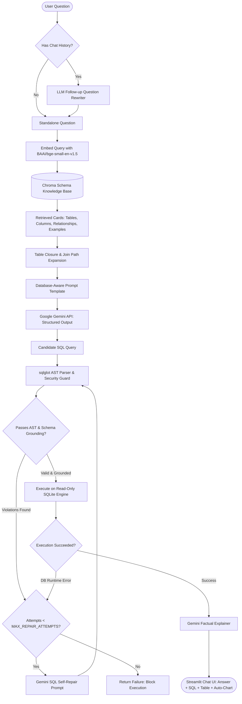

# Architecture & System Design: Natural Language to SQL Agent

## 1. System Overview

The **Natural Language to SQL Agent** provides a robust, schema-grounded interface for conversational data analytics over structured relational databases. It translates business questions into executable SQL, validates queries for structural safety and schema alignment, executes them against read-only database connections, and explains findings in natural language.

---

## 2. Component Pipeline & Data Flow

### Step 1: Follow-up Question Resolution
- For conversational sessions, non-technical users often ask elliptical follow-ups (e.g., *"now only for 2025"*, *"which of those are in Mumbai?"*).
- A heuristic filter checks whether recent conversational context is needed. If true, a dedicated rewritter prompt condenses chat history and latest user utterance into a self-contained, standalone analytical question.

### Step 2: Semantic Schema Retrieval with Table Closure
- Rather than dumping the entire schema catalog into the LLM context, the system queries a local **Chroma** vector database containing:
  1. **Table Cards:** Descriptions, primary keys, and implied foreign key joins.
  2. **Column Cards:** Column types, data dictionaries, allowed enums, and sanitized distinct sample values.
  3. **Relationship Cards:** Explicit ANSI join paths between primary and foreign keys.
  4. **Curated Few-Shot Cards:** Distinct examples demonstrating idiomatic SQL patterns (GROUP BY with HAVING, subqueries, NULL anti-joins, date windowing).
- **Table Closure Enforcement:** Every table implied by retrieved columns or relationships is guaranteed to have its complete table card included, preventing incomplete table context.

### Step 3: Database-Aware Structured Generation
- Prompt templates strictly instruct the model to use **only** retrieved entities.
- Generates typed Pydantic models (`SQLGenerationOutput`) containing:
  - `sql`: The executable query (or `null`).
  - `assumptions`: Business assumptions made to resolve ambiguities.
  - `cannot_answer_reason`: Grounded explanation if the requested data does not exist in the schema.

### Step 4: Multi-Stage AST Validation
Before any query touches the database, `sqlglot` inspects the abstract syntax tree (AST):
1. **Single-Statement Rule:** Rejects multi-statement inputs.
2. **Read-Only Constraint:** Forbids all DML/DDL expressions (`INSERT`, `UPDATE`, `DELETE`, `DROP`, `ALTER`, `CREATE`, `PRAGMA`).
3. **Schema Grounding Verification:** Validates that every referenced table and column physically exists in the database schema, resolving aliases and CTEs.
4. **LIMIT Enforcement:** Automatically injects a row limit on non-aggregate queries to protect UI performance.
5. **Dry-Run Planning:** Pre-validates execution plans with `EXPLAIN QUERY PLAN`.

### Step 5: Bounded Self-Repair Loop
- If validation finds syntax errors or unknown identifiers, the query is sent to `get_sql_repair_prompt()` alongside the exact compiler violations.
- The repair loop is strictly bounded by `MAX_REPAIR_ATTEMPTS` (default: 2) to eliminate infinite loops and prevent unbounded API costs.
- Queries that fail validation are **never executed**.

### Step 6: Safe Execution & Conversational Explanation
- Queries execute over a connection-level read-only engine (`mode=ro` in SQLite).
- The result rows are previewed and fed to an explanation prompt that is strictly instructed never to extrapolate or hallucinate figures.

---

## 3. Design Decisions & Rationale

| Architectural Decision | Chosen Approach | Alternative Considered | Rationale |
|---|---|---|---|
| **Schema Representation** | Semantic Retrieval via Chroma | Dumping entire schema into prompt | Scales gracefully to enterprise schemas with hundreds of tables; prevents attention dilution and hallucinations. |
| **Embeddings** | Local `BAAI/bge-small-en-v1.5` | Remote OpenAI or Gemini Embeddings | 100% offline, zero API quota usage, zero network latency, deterministic retrieval. |
| **Safety Enforcement** | Dual-Layer: `sqlglot` AST validation + Connection `mode=ro` | Regex or LLM self-moderation | Regex is easily bypassed by comments or subqueries. Connection-level read-only guarantees write impossibility at the driver level. |
| **Agentic Framework** | LangChain primitives (runnables, templates, output parsers) | LangGraph / Autonomous Agent Loops | Small, predictable, deterministic execution pipelines are easier to debug, test, benchmark, and maintain. |

